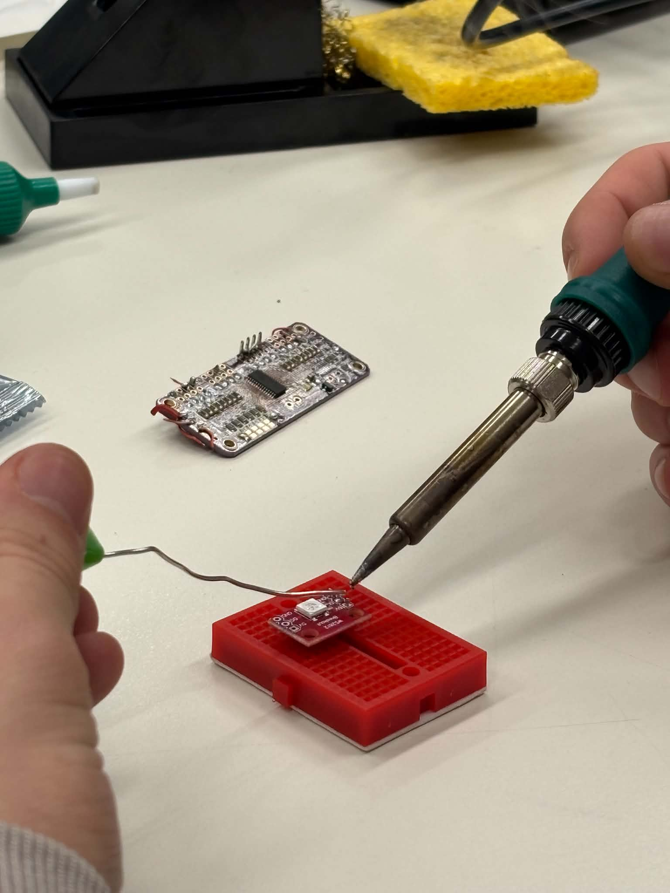
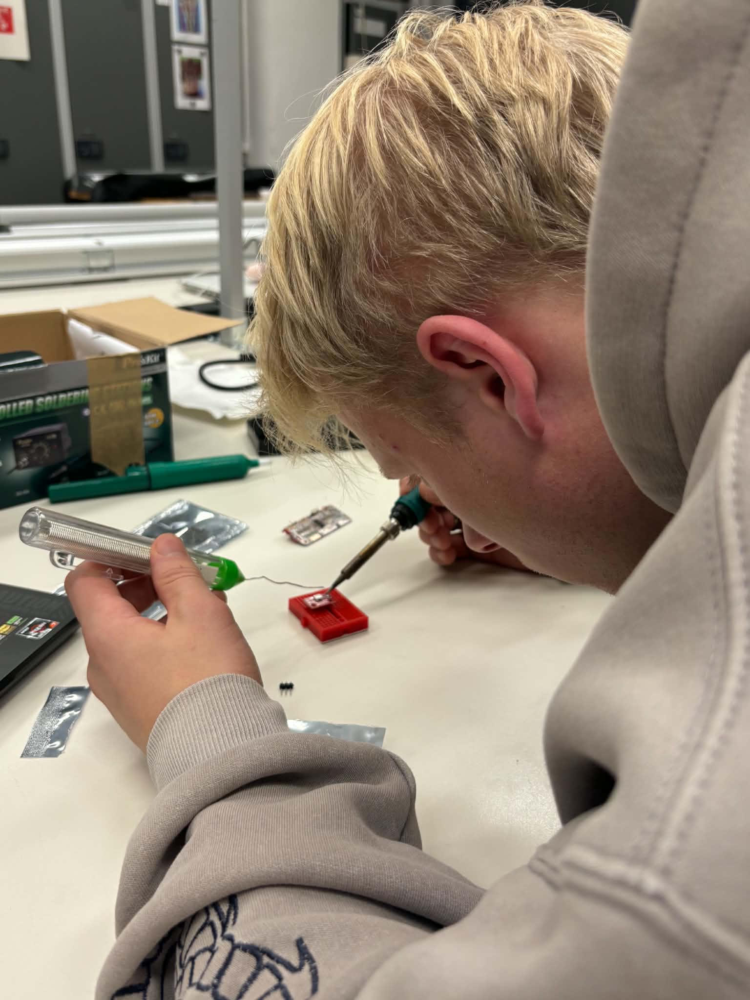
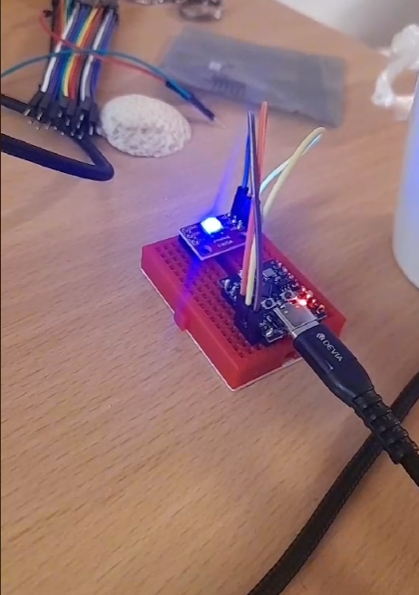

# D5 – Implementation

Realizácia prototypu Light Potion: zapojenie na nepájivom poli, firmvér a aplikácia pre Android. Zdrojový kód je v repozitári [github.com/AweFilko/LightPotion](https://github.com/AweFilko/LightPotion).

## Stav implementácie

| Časť | Zodpovedný | Stav |
|---|---|---|
| Zapojenie prototypu (ESP32-C3 Super Mini a WS2812) | Filip Brutovský | Hotovo |
| Firmvér v0.1.0 | Filip Brutovský | Hotovo a otestované |
| Aplikácia pre Android v0.1.0 | Lucia Kačmárová | Hotovo a otestované na telefóne |
| Jednotkové testy mapovania | Lucia Kačmárová | Hotovo, všetkých 15 testov prešlo |
| Batéria, spínanie MOSFETom, tlačidlo vo viečku | Filip Brutovský | Plánované vo finálnej verzii |
| 3D tlač fľaštičky a zloženie | Filip Brutovský | Plánované (M8) |

## 1. Hardvér

*Zodpovedný: Filip Brutovský*

### Spájkovanie

Na modul WS2812 bolo treba prispájkovať kolíkovú lištu, aby sa dal zasunúť do nepájivého poľa. Filip spájkoval v škole na spájkovacej stanici.





### Zapojenie

Modul LED a doska ESP32-C3 Super Mini sú na jednom malom nepájivom poli a prepojené káblami Dupont:

| Modul WS2812 | ESP32-C3 Super Mini |
|---|---|
| GND | G |
| 5V | 3V3 |
| DI | GPIO4 |

Doska je napájaná káblom USB-C, ktorým sa zároveň nahráva firmvér a číta sériový výpis.



*Prvé rozsvietenie: prototyp na nepájivom poli, LED svieti modrou farbou kategórie „správa“.*

## 2. Firmvér

*Zodpovedný: Filip Brutovský*

Štruktúra:

```text
firmware/
  platformio.ini      # espressif32 8.0.0, NimBLE-Arduino 2.5.2, FastLED 3.10.9
  include/config.h    # všetky nastavenia na jednom mieste
  src/main.cpp        # spojenie modulov
  src/ble_service.*   # Bluetooth LE služba
  src/led_effect.*    # animácia blikania a zhasnutia
  TESTING.md          # postup testu cez nRF Connect
```

Kompilácia a nahratie:

```sh
cd firmware
pio run              # kompilácia
pio run -t upload    # nahratie do dosky
pio device monitor   # sériový výpis, 115200 baud
```

Po štarte doska vypíše:

```text
LightPotion fw 0.1.0
BLE advertising
```

Pri každej udalosti zapíše jeden krátky riadok, napríklad `BLE connected`, `RX category=2 urgency=0`, `animation start`.

## 3. Aplikácia pre Android

*Zodpovedná: Lucia Kačmárová*

Štruktúra:

```text
android/app/src/main/java/com/lightpotion/app/
  MainActivity.kt
  ble/BleContract.kt                    # UUID a formát správy
  ble/BleConnectionManager.kt           # hľadanie, pripojenie, fronta zápisov
  notify/LightPotionNotificationListener.kt
  notify/NotificationMapper.kt          # kategória a naliehavosť
  service/ConnectionService.kt          # služba v popredí
  ui/PermissionsScreen.kt, HomeScreen.kt, SetupStatus.kt
android/app/src/test/.../NotificationMapperTest.kt
```

Kompilácia a inštalácia (potrebné Android SDK a JDK 17):

```sh
cd android
./gradlew assembleDebug        # APK v app/build/outputs/apk/debug/
./gradlew testDebugUnitTest    # jednotkové testy
adb install app/build/outputs/apk/debug/app-debug.apk
```

Prvé spustenie:

1. Aplikácia ukáže zoznam povolení. Povoliť Bluetooth, notifikácie aplikácie a prístup k notifikáciám (otvorí sa nastavenie systému, kde treba zapnúť Light Potion).
2. Odporúča sa povoliť aj výnimku z optimalizácie batérie, aby Android aplikáciu na pozadí nezastavil.
3. Na domovskej obrazovke sa stav zmení na „Connected“, keď je doska zapnutá a v dosahu.
4. Testovacie tlačidlá Call, Message, Email a Other pošlú farbu bez skutočnej notifikácie.

## 4. Spôsob práce

Tím si prácu rozdelil podľa častí: Filip má na starosti hardvér a firmvér, Lucia aplikáciu. Rozhranie medzi nimi je pevne dané protokolom Bluetooth (pozri [D4](../04.D4-Design/index.md)), takže obe časti vznikali súbežne a dali sa testovať samostatne. Technické zadanie projektu je spísané v súbore `CLAUDE.md` (hardvér, protokol, správanie, pravidlá súkromia, kritériá prijatia). Pri programovaní a dokumentácii tím využíval AI asistenta Claude Code ako pomocný nástroj. Každý krok má samostatný commit v gite.

## 5. Čo ešte príde

- **Finálny hardvér:** prechod na Seeed XIAO ESP32-C3 s batériou 250 mAh, tri LED, spínanie napájania LED cez MOSFETy Q1 a Q2 (GPIO3) a tlačidlo vo viečku. Pin LED (GPIO4) aj počet LED sú v `config.h`, takže zmena firmvéru bude malá.
- **Úsporný režim:** vypínanie napájania LED v pokoji, dlhší interval Bluetooth spojenia, nastavenie GPIO4 nízko pred vypnutím LED.
- **Kontrola batérie:** pri slabej batérii červené bliknutie a hlboký spánok.
- **Bezpečnosť:** párovanie a šifrované spojenie.
- **Puzdro:** 3D tlač fľaštičky, montáž do nej a fotky hotového kusu.

---
**Navigation:** [⬆️ Up](../index.md) · [🏠 Home](../index.md)
